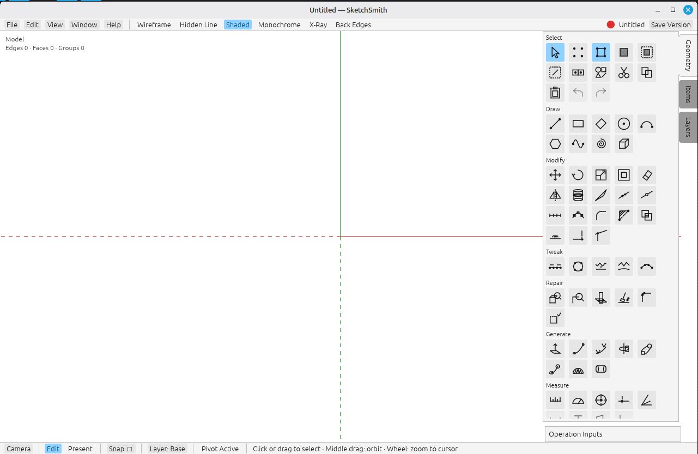
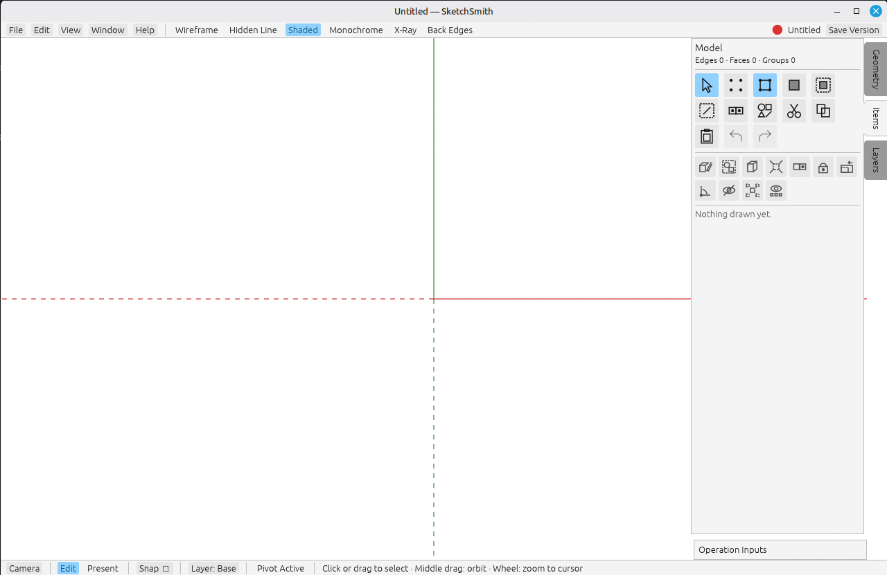
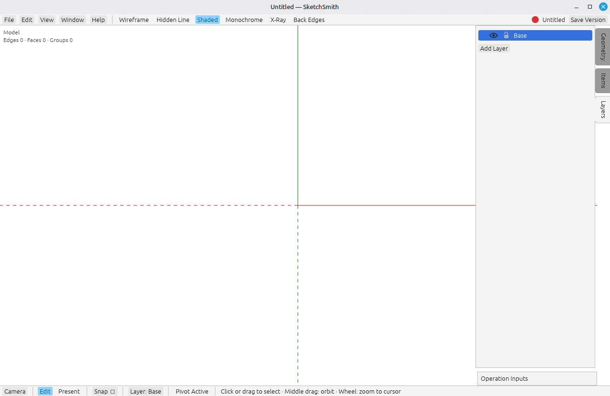

# SketchSmith

Sketch ideas in 3D and hand them off: a light 3D sketching application for Linux, in
the spirit of SketchUp's push-and-pull modelling. Draw edges and faces, extrude, loft,
revolve and skin them, paint and label them, and export to OBJ, STL, glTF, 3MF, STEP,
DXF, PDF, SVG and PNG. SketchUp `.skp` files (2013–2020) import with their groups,
components, layers, paint, guides and labels.

**Version:** 1.0.0 — Thursday 12 November 2026
**Flatpak ID:** `io.github.archerprojects.SketchSmith`
**Platform:** Linux (Flatpak) · Wayland and X11 · x86_64
**Developer:** archerprojects — <archer.projects@proton.me> · GitHub [@archerprojects](https://github.com/archerprojects)
**Licence:** GPL-3.0-or-later (see [`LICENSE`](LICENSE) and [`THIRD_PARTY_NOTICES.md`](THIRD_PARTY_NOTICES.md))

---

## Screenshots

*Geometry:*



*Items:*



*Layers:*



---

## Install

SketchSmith is released **on GitHub only**: it is not on Flathub. Each release on the
[releases page](https://github.com/archerprojects/sketchsmith/releases) has a `.flatpak`
file, and that file is **not self-contained**. It needs a *runtime*: the shared base of
libraries every Flatpak app runs on. SketchSmith uses the **freedesktop 26.08 runtime**,
and that comes from Flathub. So Flathub supplies only the runtime; SketchSmith itself
comes from GitHub. Install them in this order, each step one command pasted into a
terminal (**Ctrl+Alt+T**).

> [!IMPORTANT]
> **Install with the commands below. Don't use Software Manager or any other app store
> or Flatpak manager.** They install it system-wide, and an older copy in your home
> installation keeps starting instead. The commands use `--user`, which puts SketchSmith
> in your own home installation.

### Required runtimes

SketchSmith needs these, all from Flathub. Steps 1 and 2 below install them; you never
install the graphics drivers by hand.

| Runtime | What it is | Needed | Link |
|---|---|---|---|
| `org.freedesktop.Platform//26.08` | The base runtime: the libraries SketchSmith runs on | Always (step 2) | [freedesktop SDK](https://freedesktop-sdk.io/) · [source](https://gitlab.com/freedesktop-sdk/freedesktop-sdk) |
| `org.freedesktop.Platform.GL.default//26.08` | Graphics drivers (Mesa: Intel, AMD and others) | Always; installed with the runtime | [freedesktop SDK](https://gitlab.com/freedesktop-sdk/freedesktop-sdk) |
| `org.freedesktop.Platform.GL.nvidia-<driver version>` | NVIDIA's graphics driver, matching the one on your system | NVIDIA cards only; installed with the runtime | [Flathub](https://github.com/flathub/org.freedesktop.Platform.GL.nvidia) |
| Flathub remote | Where the runtimes come from | Always (step 1) | [flathub.flatpakrepo](https://dl.flathub.org/repo/flathub.flatpakrepo) |

Flatpak may also install the runtime's Locale, VAAPI and codecs extensions. SketchSmith
doesn't use them; they are optional.

To check what is installed:

```bash
flatpak list --runtime | grep -E 'Platform.*26.08|GL'
```

> [!NOTE]
> **NVIDIA cards:** after a driver update, the extension matching the new driver may
> not be installed yet. Fetch it with:
>
> ```bash
> flatpak update --user
> ```

**1. Flatpak and the Flathub remote (once per machine).** Linux Mint and Fedora already
have Flatpak; on Ubuntu or Debian, first run `sudo apt install flatpak` (other systems:
[Flatpak setup](https://flatpak.org/setup/)). Then add Flathub, where the runtime comes
from ([Flathub's repository file](https://dl.flathub.org/repo/flathub.flatpakrepo)):

```bash
flatpak remote-add --if-not-exists --user flathub https://dl.flathub.org/repo/flathub.flatpakrepo
```

**2. The runtime (once per machine).** `org.freedesktop.Platform//26.08`, from the
[freedesktop SDK project](https://freedesktop-sdk.io/) (see also Flatpak's
[list of runtimes](https://docs.flatpak.org/en/latest/available-runtimes.html)): about
283 MB to download, 724 MB installed. Flatpak also fetches its graphics and language
extensions with it, including the driver extension that matches your graphics card.

```bash
flatpak install -y --user flathub org.freedesktop.Platform//26.08
```

**3. SketchSmith (to install, and to update).**

> [!TIP]
> Download the `.flatpak` file (for example `SketchSmith-1.0.0-x86_64.flatpak`)
> from the **Assets** list at the bottom of the latest release:
> https://github.com/archerprojects/sketchsmith/releases/latest
>
> Your browser saves it to your **Downloads** folder. Then paste the command below. It
> installs the newest SketchSmith file in Downloads into your home installation; you
> don't need to change folder or type the version.

```bash
flatpak install -y --user --reinstall "$(ls -t ~/Downloads/SketchSmith-*-x86_64.flatpak | head -1)"
```

**4. Run.** Open **SketchSmith** from the Graphics menu, or:

```bash
flatpak run io.github.archerprojects.SketchSmith
```

### Update

Download the new `.flatpak` from the latest release and paste the step 3 command again.
It replaces the copy in your home installation. Your settings and keymaps are kept: they
live in `~/.var/app/io.github.archerprojects.SketchSmith/`, outside the app, and
installing never touches them. Your models are wherever you saved them.
If it says "This version … is already installed", you already have the latest release.
The runtime (steps 1 and 2) is not needed again.

### If an older version keeps starting

A copy installed system-wide (for example by Software Manager) never starts while a copy
sits in your home installation. Download the latest release and paste the step 3 command:
the copy it puts in your home installation is the one that starts. To see every copy:

```bash
flatpak list --app --columns=application,version,installation | grep -i sketchsmith
```

### Uninstall

Remove every copy (your settings in `~/.var/app/` are kept unless you delete them):

```bash
flatpak uninstall --user io.github.archerprojects.SketchSmith
flatpak uninstall --system io.github.archerprojects.SketchSmith
```

The second line asks for your password, and says nothing is installed if there is no
system-wide copy.

---

## Build from source (developers only, not needed to install)

SketchSmith is written in Rust (winit, wgpu and egui). It needs **Rust 1.95** or newer.

```bash
cargo run -p sketchsmith                 # run while developing
cargo build --workspace --release        # release build: target/release/sketchsmith
cargo test --workspace                   # the tests
```

To build the Flatpak bundle yourself you need **flatpak** and **flatpak-builder**, and
the freedesktop **SDK 26.08** with its **Rust extension**:

```bash
flatpak install flathub org.freedesktop.Platform//26.08 org.freedesktop.Sdk//26.08 org.freedesktop.Sdk.Extension.rust-stable//26.08
```

Then, from the repository folder (regenerate `cargo-sources.json` first whenever
`Cargo.lock`'s external crates change, with `flatpak-cargo-generator.py` from
[flatpak-builder-tools](https://github.com/flatpak/flatpak-builder-tools)):

```bash
python3 flatpak-cargo-generator.py Cargo.lock -o packaging/flatpak/cargo-sources.json
flatpak-builder --install-deps-from=flathub --force-clean --repo=repo build-dir packaging/flatpak/io.github.archerprojects.SketchSmith.yml
flatpak build-bundle repo SketchSmith-1.0.0-x86_64.flatpak io.github.archerprojects.SketchSmith --runtime-repo=https://flathub.org/repo/flathub.flatpakrepo
```

---

## Credits & Licensing

SketchSmith is free software under the GNU General Public License, version 3 or later
([`LICENSE`](LICENSE)). The licences of the crates it is built from, and of OpenSKP,
whose `.skp` reader it ports, are in [`THIRD_PARTY_NOTICES.md`](THIRD_PARTY_NOTICES.md).

SketchSmith is not affiliated with or endorsed by Trimble. "SketchUp" is used only to
name a file format SketchSmith can read.

---

*End README.md — version 1.0.0 — Thursday 12 November 2026*
